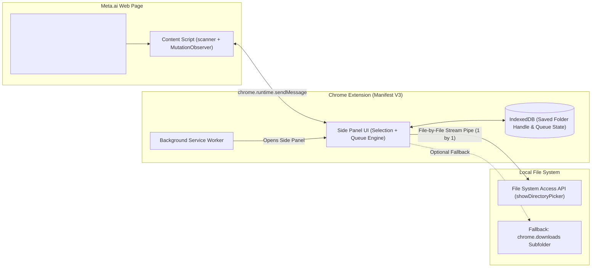

# Meta.AI Video Downloader — Chrome Extension (Manifest V3)

🌐 **Languages / Ngôn ngữ:** [English](#english-documentation) | [Tiếng Việt](#tài-liệu-tiếng-việt)

A lightweight, full-featured **Chrome Extension (Manifest V3)** designed to scan **Meta.ai** (`https://www.meta.ai/*`) pages, extract all generated `.mp4` video streams (`scontent.xx.fbcdn.net`), allow selective video picking, let the user choose any local destination folder, and download videos reliably using a **sequential (file-by-file) auto-download queue**.

Một **Tiện ích mở rộng Chrome (Manifest V3)** gọn nhẹ, đầy đủ tính năng giúp quét trang **Meta.ai** (`https://www.meta.ai/*`), trích xuất toàn bộ luồng video `.mp4` đã tạo (`scontent.xx.fbcdn.net`), cho phép chọn lọc video, đổi tên hàng loạt, chọn thư mục lưu trữ bất kỳ trên máy tính và tải xuống tự động **tuần tự từng file một**.

---

## 🚀 Quick Install / Cài đặt nhanh

### 🇬🇧 English
1. Open Google Chrome and navigate to `chrome://extensions/`.
2. Enable **Developer mode** (toggle in the top-right corner).
3. Click **Load unpacked** and select this project root folder (`Download Meta Video`).
4. Open [https://www.meta.ai](https://www.meta.ai) and click the **Meta.AI Video Downloader** extension icon in your toolbar to open the Side Panel.
5. Click **Scan Page** (or scroll to auto-detect videos), check the videos you want, click **Select Folder**, and press **Start Auto Queue**.

### 🇻🇳 Tiếng Việt
1. Mở trình duyệt Google Chrome và truy cập vào địa chỉ `chrome://extensions/`.
2. Bật chế độ **Developer mode (Chế độ dành cho nhà phát triển)** ở góc trên bên phải.
3. Nhấn vào nút **Load unpacked (Tải tiện ích đã giải nén)** và chọn thư mục gốc của dự án này (`Download Meta Video`).
4. Mở trang [https://www.meta.ai](https://www.meta.ai) và nhấn vào biểu tượng tiện ích **Meta.AI Video Downloader** trên thanh công cụ để mở bảng điều khiển bên (Side Panel).
5. Nhấn **Scan Page** (hoặc cuộn trang để tự động phát hiện video), tích chọn các video muốn tải, nhấn **Select Folder** để chọn thư mục lưu và nhấn **Start Auto Queue** để bắt đầu tải tự động.

---

<a id="english-documentation"></a>

## 🇬🇧 English Documentation

### Key Features

1. **Smart Meta.ai HTML & DOM Scanner**
   - Automatically extracts `.mp4` URLs from `<video>` elements even when `controlslist="nodownload"` is set:
     ```html
     <video class="h-full w-full object-contain" playsinline="" controlslist="nodownload" loop=""
       src="https://scontent.xx.fbcdn.net/v/t39.105495-1/902044508_1849482556051902_4641685168229180870_n.mp4?_nc_ht=scontent.xx.fbcdn.net&amp;_nc_cat=106..."></video>
     ```
   - Preserves signed CDN query tokens (`_nc_ht`, `_nc_ohc`, `oh`, `oe`) required by `fbcdn.net` while extracting clean `.mp4` filenames (`902044508_1849482556051902_4641685168229180870_n.mp4`).
   - Uses a live `MutationObserver` to capture and cache videos as you scroll through Meta.ai's virtualized feed.

2. **Interactive Video Selection & Rename UI (Chrome Side Panel)**
   - Persistent **Chrome Side Panel** (`chrome.sidePanel`) that stays open alongside Meta.ai without closing when clicking the page or opening OS dialogs.
   - **Select All / Deselect All:** Master checkbox (supports checked, indeterminate `-`, and unchecked states) plus explicit **☑ Select All**, **☐ Deselect All**, **⇄ Invert**, **⏳ Pending**, and `Shift+Click` range selection.
   - **Edit Save Name per Clip:** Every clip card has an inline editable filename box (`.mp4` added automatically) with an individual `↺` reset button.
   - **Auto New Name All Selected (Top → Bottom Order):** Bulk-rename all selected clips in sequence from top to bottom (`#01`, `#02`, `#03`...) using customizable base names and patterns (`clip_01.mp4`, `01_clip.mp4`, `01.mp4`, `01_original.mp4`), with an optional **Auto-renumber on select** live toggle.
   - **Local Storage History & File Filters:** Saves both the video queue list and completed download history to `localStorage` (recognizing previously downloaded clips with a `🕒 History` badge across browser restarts) and provides 1-click filter tabs (**All**, **Selected**, **Unselected**, **Pending / New**, **Downloaded / History**, **Renamed**, **Failed**).

3. **Custom Destination Folder Selection**
   - **Primary Engine (Native OS Folder Picker):** Uses the **File System Access API (`window.showDirectoryPicker`)** so you can pick **any folder on any drive** (e.g., `E:\AI_Videos\MetaBatch1`) with zero repetitive "Save As" prompts.
   - **Fallback Engine (`chrome.downloads` Subfolder):** Supports saving directly into a named subfolder inside Chrome's default `Downloads/` directory.

4. **Sequential Auto-Download Queue (File-by-File)**
   - Downloads selected videos strictly **one by one (`concurrency = 1`)** to prevent CDN rate-limiting (`HTTP 429`) and keep disk writes ordered.
   - Real-time per-file byte progress bar + overall queue progress counter.
   - Full queue controls: **Start**, **Pause**, **Resume**, **Skip**, and **Retry Failed** with automatic exponential backoff.

---

### System Architecture



---

### Planned Project Structure

```text
Download Meta Video/
├── docs/
│   └── researching-guide.md      # Deep-dive DOM analysis, GitHub open-source review & architecture
├── src/
│   ├── background/
│   │   └── service-worker.js     # Side panel activation & fallback download listener
│   ├── content/
│   │   └── content-scanner.js    # Meta.ai <video> DOM scanner + MutationObserver
│   ├── sidepanel/
│   │   ├── index.html            # Side Panel UI layout
│   │   ├── styles.css            # Modern dark/light UI styling
│   │   └── sidepanel.js          # UI controller & selection state
│   └── utils/
│       ├── folder-manager.js     # showDirectoryPicker + IndexedDB handle persistence
│       ├── queue-engine.js       # Sequential file-by-file auto-download state machine
│       └── url-parser.js         # fbcdn.net URL sanitizer, filename & 'oe' expiry parser
├── assets/
│   └── icons/                    # Extension icons (16, 48, 128px)
├── manifest.json                 # Chrome Extension Manifest V3 configuration
├── tasks.md                      # Step-by-step full-stack development checklist
└── README.md                     # Project overview and usage documentation
```

---

### Documentation Links

- [**Implementation Tasks (`tasks.md`)**](./tasks.md) — Phased engineering checklist from scaffolding to testing.
- [**Researching Guide (`docs/researching-guide.md`)**](./docs/researching-guide.md) — Target HTML breakdown, GitHub open-source comparisons, and architectural trade-offs.

---

<a id="tài-liệu-tiếng-việt"></a>

## 🇻🇳 Tài liệu Tiếng Việt

### Tính năng nổi bật

1. **Bộ quét HTML & DOM Meta.ai thông minh**
   - Tự động trích xuất đường dẫn `.mp4` từ các thẻ `<video>` ngay cả khi thuộc tính `controlslist="nodownload"` được bật:
     ```html
     <video class="h-full w-full object-contain" playsinline="" controlslist="nodownload" loop=""
       src="https://scontent.xx.fbcdn.net/v/t39.105495-1/902044508_1849482556051902_4641685168229180870_n.mp4?_nc_ht=scontent.xx.fbcdn.net&amp;_nc_cat=106..."></video>
     ```
   - Giữ nguyên các token xác thực CDN (`_nc_ht`, `_nc_ohc`, `oh`, `oe`) bắt buộc của `fbcdn.net` đồng thời tách tên file `.mp4` gốc sạch sẽ (`902044508_1849482556051902_4641685168229180870_n.mp4`).
   - Sử dụng `MutationObserver` thời gian thực để tự động bắt và lưu đệm danh sách video khi bạn cuộn trang trên bảng tin ảo hóa của Meta.ai.

2. **Giao diện chọn & đổi tên video trực quan (Chrome Side Panel)**
   - **Bảng điều khiển bên (`chrome.sidePanel`)** luôn mở cố định cạnh trang Meta.ai mà không bị tự đóng khi bạn nhấp chuột vào trang web hoặc mở hộp thoại chọn thư mục.
   - **Chọn tất cả / Bỏ chọn tất cả:** Ô tích tổng (hỗ trợ trạng thái chọn hết, chọn một phần `-`, và bỏ chọn) cùng các nút thao tác nhanh **☑ Select All (Chọn tất cả)**, **☐ Deselect All (Bỏ chọn)**, **⇄ Invert (Đảo ngược)**, **⏳ Pending (Chưa tải)** và giữ `Shift+Click` để chọn theo vùng.
   - **Sửa tên lưu cho từng video:** Mỗi thẻ video có ô nhập tên file trực tiếp (tự động thêm đuôi `.mp4`) kèm nút `↺` để khôi phục tên gốc.
   - **Đổi tên tự động hàng loạt theo thứ tự (Từ trên xuống dưới):** Đánh số thứ tự hàng loạt cho các video đang chọn từ trên xuống dưới (`#01`, `#02`, `#03`...) với tiền tố và mẫu tùy chỉnh (`clip_01.mp4`, `01_clip.mp4`, `01.mp4`, `01_original.mp4`), hỗ trợ bật/tắt **Auto-renumber on select** (tự động cập nhật lại số thứ tự ngay khi tích/bỏ tích).
   - **Lưu lịch sử Local Storage & Bộ lọc file:** Lưu cả danh sách chờ lẫn lịch sử các video đã tải vào `localStorage` (nhận diện các video đã tải trước đó bằng nhãn `🕒 History` kể cả sau khi khởi động lại trình duyệt) và cung cấp các tab lọc 1 chạm (**All**, **Selected**, **Unselected**, **Pending / New**, **Downloaded / History**, **Renamed**, **Failed**).

3. **Tùy chọn thư mục lưu trữ linh hoạt**
   - **Chế độ chính (Hộp thoại chọn thư mục hệ điều hành):** Sử dụng **File System Access API (`window.showDirectoryPicker`)** cho phép chọn **bất kỳ thư mục nào trên mọi ổ đĩa** (ví dụ: `E:\AI_Videos\MetaBatch1`) mà không bị hỏi hộp thoại "Save As" lặp lại cho từng file.
   - **Chế độ dự phòng (Thư mục con trong `chrome.downloads`):** Hỗ trợ lưu trực tiếp vào một thư mục con định sẵn bên trong thư mục `Downloads/` mặc định của Chrome.

4. **Hàng đợi tải xuống tự động tuần tự (Từng file một)**
   - Tải xuống các video đã chọn **tuần tự từng file một (`concurrency = 1`)** giúp tránh bị giới hạn băng thông từ CDN (`HTTP 429`) và đảm bảo thứ tự ghi file.
   - Thanh tiến trình dung lượng theo thời gian thực cho từng file + bộ đếm tiến độ toàn hàng đợi.
   - Đầy đủ nút điều khiển hàng đợi: **Start (Bắt đầu)**, **Pause (Tạm dừng)**, **Resume (Tiếp tục)**, **Skip (Bỏ qua)** và **Retry Failed (Thử lại file lỗi)** với cơ chế tự động thử lại (exponential backoff).

---

### Liên kết tài liệu

- [**Danh sách công việc triển khai (`tasks.md`)**](./tasks.md) — Checklist kỹ thuật chi tiết theo từng giai đoạn từ khởi tạo đến kiểm thử.
- [**Tài liệu nghiên cứu (`docs/researching-guide.md`)**](./docs/researching-guide.md) — Phân tích cấu trúc HTML mục tiêu, đối chiếu các dự án mã nguồn mở trên GitHub và kiến trúc hệ thống.

