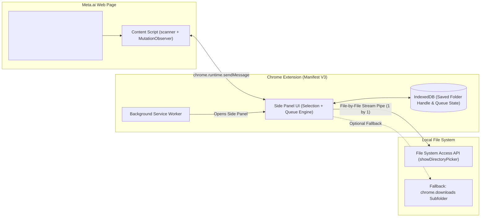

# Meta.AI Video Downloader — Chrome Extension (Manifest V3)

A lightweight, full-featured **Chrome Extension (Manifest V3)** designed to scan **Meta.ai** (`https://www.meta.ai/*`) pages, extract all generated `.mp4` video streams (`scontent.xx.fbcdn.net`), allow selective video picking, let the user choose any local destination folder, and download videos reliably using a **sequential (file-by-file) auto-download queue**.

---

## Key Features

1. **Smart Meta.ai HTML & DOM Scanner**
   - Automatically extracts `.mp4` URLs from `<video>` elements even when `controlslist="nodownload"` is set:
     ```html
     <video class="h-full w-full object-contain" playsinline="" controlslist="nodownload" loop=""
       src="https://scontent.xx.fbcdn.net/v/t39.105495-1/902044508_1849482556051902_4641685168229180870_n.mp4?_nc_ht=scontent.xx.fbcdn.net&amp;_nc_cat=106..."></video>
     ```
   - Preserves signed CDN query tokens (`_nc_ht`, `_nc_ohc`, `oh`, `oe`) required by `fbcdn.net` while extracting clean `.mp4` filenames (`902044508_1849482556051902_4641685168229180870_n.mp4`).
   - Uses a live `MutationObserver` to capture and cache videos as you scroll through Meta.ai's virtualized feed.

2. **Interactive Video Selection & Rename UI (Chrome Side Panel)**
   - Persistent **Chrome Side Panel** (`chrome.sidePanel`) that stays open alongside Meta.ai without closing when clicking the page or opening OS dialogs.
   - **Select All / Deselect All:** Master checkbox (supports checked, indeterminate `-`, and unchecked states) plus explicit **☑ Select All**, **☐ Deselect All**, **⇄ Invert**, **⏳ Pending**, and `Shift+Click` range selection.
   - **Edit Save Name per Clip:** Every clip card has an inline editable filename box (`.mp4` added automatically) with an individual `↺` reset button.
   - **Auto New Name All Selected (Top → Bottom Order):** Bulk-rename all selected clips in sequence from top to bottom (`#01`, `#02`, `#03`...) using customizable base names and patterns (`clip_01.mp4`, `01_clip.mp4`, `01.mp4`, `01_original.mp4`), with an optional **Auto-renumber on select** live toggle.
   - **Local Storage History & File Filters:** Saves both the video queue list and completed download history to `localStorage` (recognizing previously downloaded clips with a `🕒 History` badge across browser restarts) and provides 1-click filter tabs (**All**, **Selected**, **Unselected**, **Pending / New**, **Downloaded / History**, **Renamed**, **Failed**).

3. **Custom Destination Folder Selection**
   - **Primary Engine (Native OS Folder Picker):** Uses the **File System Access API (`window.showDirectoryPicker`)** so you can pick **any folder on any drive** (e.g., `E:\AI_Videos\MetaBatch1`) with zero repetitive "Save As" prompts.
   - **Fallback Engine (`chrome.downloads` Subfolder):** Supports saving directly into a named subfolder inside Chrome's default `Downloads/` directory.

4. **Sequential Auto-Download Queue (File-by-File)**
   - Downloads selected videos strictly **one by one (`concurrency = 1`)** to prevent CDN rate-limiting (`HTTP 429`) and keep disk writes ordered.
   - Real-time per-file byte progress bar + overall queue progress counter.
   - Full queue controls: **Start**, **Pause**, **Resume**, **Skip**, and **Retry Failed** with automatic exponential backoff.

---

## System Architecture



---

## Planned Project Structure

```text
Download Meta Video/
├── docs/
│   └── researching-guide.md      # Deep-dive DOM analysis, GitHub open-source review & architecture
├── src/
│   ├── background/
│   │   └── service-worker.js     # Side panel activation & fallback download listener
│   ├── content/
│   │   └── content-scanner.js    # Meta.ai <video> DOM scanner + MutationObserver
│   ├── sidepanel/
│   │   ├── index.html            # Side Panel UI layout
│   │   ├── styles.css            # Modern dark/light UI styling
│   │   └── sidepanel.js          # UI controller & selection state
│   └── utils/
│       ├── folder-manager.js     # showDirectoryPicker + IndexedDB handle persistence
│       ├── queue-engine.js       # Sequential file-by-file auto-download state machine
│       └── url-parser.js         # fbcdn.net URL sanitizer, filename & 'oe' expiry parser
├── assets/
│   └── icons/                    # Extension icons (16, 48, 128px)
├── manifest.json                 # Chrome Extension Manifest V3 configuration
├── tasks.md                      # Step-by-step full-stack development checklist
└── README.md                     # Project overview and usage documentation
```

---

## Quick Start (Development)

1. Open Google Chrome and navigate to `chrome://extensions/`.
2. Enable **Developer mode** (toggle in the top-right corner).
3. Click **Load unpacked** and select this project root folder (`Download Meta Video`).
4. Open [https://www.meta.ai](https://www.meta.ai) and click the **Meta.AI Video Downloader** extension icon in your toolbar to open the Side Panel.
5. Click **Scan Page** (or scroll to auto-detect videos), check the videos you want, click **Select Folder**, and press **Start Auto Queue**.

---

## Documentation Links

- [**Implementation Tasks (`tasks.md`)**](./tasks.md) — Phased engineering checklist from scaffolding to testing.
- [**Researching Guide (`docs/researching-guide.md`)**](./docs/researching-guide.md) — Target HTML breakdown, GitHub open-source comparisons, and architectural trade-offs.

