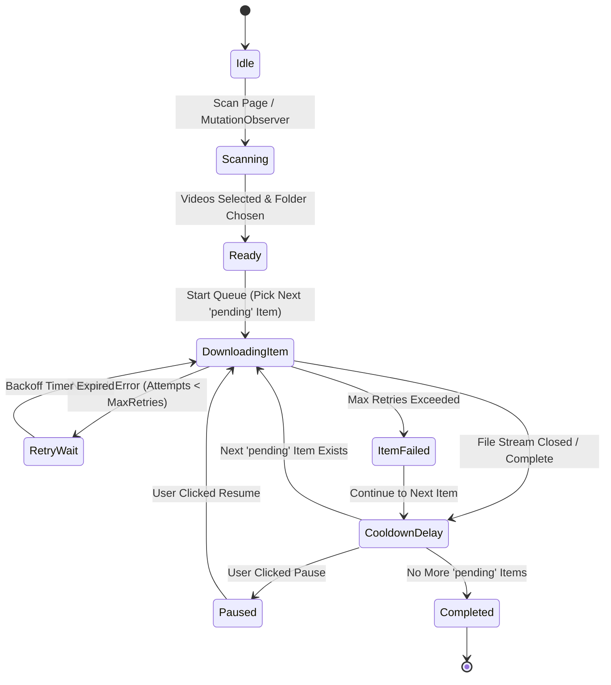

# Researching Guide: Meta.AI Video Downloader Chrome Extension

## 1. Problem Statement & Target HTML Analysis

The goal is to build a **Chrome Extension (Manifest V3)** that inspects the live DOM of **Meta.ai** (`https://www.meta.ai/*`), extracts all `.mp4` video links, allows the user to select which videos to download, lets the user pick a destination folder on disk, and processes downloads sequentially (**file-by-file auto-download queue**).

### Target HTML Element on Meta.ai

```html
<video
  class="h-full w-full object-contain"
  playsinline=""
  controlslist="nodownload"
  loop=""
  src="https://scontent.xx.fbcdn.net/v/t39.105495-1/902044508_1849482556051902_4641685168229180870_n.mp4?_nc_ht=scontent.xx.fbcdn.net&amp;_nc_cat=106&amp;_nc_ohc=-pAZN6jli1EQ7kNvwHULcyB&amp;sdl=0&amp;ccb=14-4&amp;oh=00_AQTto52-DZkV6zT_n-5LCEhlqzaJTfq0MH3yZ_Hl4WcRHg&amp;oe=6AF9E9F0&amp;_nc_sid=a21977"
></video>
```

### Technical Findings from the Target Element

| Attribute / Part | Value / Example | Engineering Implication |
| :--- | :--- | :--- |
| **Tag & Attributes** | `<video controlslist="nodownload" src="...">` | Meta disables the native browser right-click/download button via `controlslist="nodownload"`. Reading `.src` via a Content Script bypasses this UI restriction cleanly. |
| **CDN Host** | `scontent.xx.fbcdn.net` (or regional `scontent-*.fbcdn.net`) | Extension needs `*://*.fbcdn.net/*` in `host_permissions` to fetch streams or read headers without CORS errors. |
| **Clean Filename** | `902044508_1849482556051902_4641685168229180870_n.mp4` | Extracted from `new URL(videoSrc).pathname.split('/').pop()`. |
| **Signed Query Params** | `?_nc_ht=...&_nc_ohc=...&oh=...&oe=6AF9E9F0&_nc_sid=...` | **CRITICAL:** `fbcdn.net` URLs are cryptographically signed (`oh` token + `oe` hex expiration timestamp). Stripping query parameters results in `HTTP 403 Forbidden`. We must download using the **full signed URL**, while saving to disk using the **clean filename**. |
| **HTML Entity Encoding** | `&amp;` in raw HTML source vs `&` in DOM property | If parsing raw HTML strings (`innerHTML`), `&amp;` must be decoded to `&`. However, reading the DOM property `videoElement.src` or `videoElement.currentSrc` automatically returns the decoded, valid URL. |
| **SPA Virtualization** | React virtualized feed on `meta.ai` | As a user scrolls through Meta.ai, older `<video>` elements may be unmounted from the DOM to save memory. We need a `MutationObserver` in the content script that caches discovered videos in a `Map<videoId, VideoMetadata>` so scrolled-past videos remain in the selectable list. |

---

## 2. Open-Source GitHub Repositories Research

We surveyed open-source Manifest V3 Chrome extensions on GitHub to identify proven patterns for media detection, side panel UI, folder picking, and sequential download queues:

### 1. [`mohamedrepo/smart-media-downloader`](https://github.com/mohamedrepo/smart-media-downloader)
- **What it does:** A Manifest V3 media downloader extension with a persistent download queue (add, pause, resume, cancel, retry, reorder) and configurable concurrency.
- **Key Takeaway:** Uses **IndexedDB / `chrome.storage.local`** to persist queue state and implements a clean state machine (`queued` -> `downloading` -> `completed` / `failed`) so the queue doesn't break if the service worker goes idle.

### 2. [`thajj/media-downloader-extension`](https://github.com/thajj/media-downloader-extension)
- **What it does:** Manifest V3 extension that detects videos/images on the active page and displays them inside a **Chrome Side Panel** with bulk selection and a sequential queue.
- **Key Takeaway:** Using `chrome.sidePanel` instead of a standard toolbar `popup` prevents the extension UI from closing when the user interacts with the page or opens a native OS folder picker dialog.

### 3. [`brttd/Multi-file-downloader`](https://github.com/brttd/Multi-file-downloader) & `native-batch-downloader`
- **What they do:** Batch link downloaders utilizing `chrome.downloads.download({ url, filename: 'Subfolder/file.mp4', conflictAction: 'uniquify' })` paired with `chrome.downloads.onChanged` listeners.
- **Key Takeaway:** Demonstrates how to wait for Chrome's native download manager to report `state.current === 'complete'` before dequeuing the next file, plus adding a polite throttle delay (`300ms–500ms`) between downloads.

### 4. [`amzbase-com/meta-ai-automation-extension`](https://github.com/amzbase-com/meta-ai-automation-extension)
- **What it does:** Open-source Chrome extension framework targeting `meta.ai` for batch prompt generation and media extraction.
- **Key Takeaway:** Confirms how `meta.ai` dynamically mounts `<video>` tags inside its React tree and why `MutationObserver` + URL deduplication by filename ID is necessary.

---

## 3. Architectural Comparison: Choosing the Best Way

### Decision 1: Extension UI Host (Popup vs. Side Panel)

| Feature | Toolbar Popup (`action.default_popup`) | Chrome Side Panel (`chrome.sidePanel`) |
| :--- | :--- | :--- |
| **Stays open while scrolling Meta.ai?** | No (closes on outside click) | **Yes** (docked beside the webpage) |
| **Works with `window.showDirectoryPicker()`?** | **No** (Popup immediately closes when OS dialog opens, killing the script!) | **Yes** (Side Panel remains alive while user picks a folder) |
| **Real-time video preview & selection UX** | Cramped (`800x600` max) | **Full height**, comfortable list with video thumbnails |

**Winner:** **Chrome Side Panel (`chrome.sidePanel`)**.

---

### Decision 2: Folder Selection Mechanism (How to let the user choose where to save)

Chrome Extensions have two ways to save files to a user-selected directory:

#### Option A: Native File System Access API (`window.showDirectoryPicker()`) — *Recommended Primary Engine*
- **How it works:**
  1. User clicks **"Choose Folder..."** in the Side Panel.
  2. `const dirHandle = await window.showDirectoryPicker({ mode: 'readwrite' })` opens the native Windows/macOS folder picker.
  3. The user can pick **any directory on any drive** (e.g., `E:\Meta_Videos\Project_A`).
  4. The `dirHandle` is stored in **IndexedDB** so it can be reused across sessions.
  5. For each queued video, the Side Panel fetches the `.mp4` stream and pipes it directly to a file in `dirHandle`:
     ```javascript
     const response = await fetch(item.url);
     const fileHandle = await dirHandle.getFileHandle(item.filename, { create: true });
     const writable = await fileHandle.createWritable();
     await response.body.pipeTo(writable);
     ```
- **Advantages:**
  - True OS folder picker (can save to `D:\`, `E:\`, Desktop, custom project folders—not locked to Chrome's `Downloads` folder).
  - **Zero "Save As" popups** per file, even if the user enabled *"Ask where to save each file before downloading"* in Chrome settings.
  - Supports real-time byte progress tracking via `ReadableStream`.

#### Option B: `chrome.downloads` API with Subfolder Path — *Recommended Fallback Engine*
- **How it works:**
  1. User specifies a relative subfolder name (e.g., `MetaAI_Videos`).
  2. Extension calls `chrome.downloads.download({ url, filename: 'MetaAI_Videos/902044508_..._n.mp4', saveAs: false, conflictAction: 'uniquify' })`.
- **Advantages:**
  - Delegates downloading to Chrome's built-in download manager (`chrome://downloads`).
- **Limitations:**
  - Restricted strictly to subdirectories inside the user's default Chrome `Downloads` directory.

**Winner:** **Hybrid Dual-Mode (Primary: `showDirectoryPicker()` Direct Disk Stream + Fallback: `chrome.downloads` Subfolder)**. This gives users true arbitrary folder selection on any drive while keeping native Chrome downloads as an optional toggle.

---

### Decision 3: Sequential Auto-Download Queue (File-by-File)

Why strictly **file-by-file (`concurrency = 1`)** by default?
1. **Prevents CDN Throttling:** Firing 20+ simultaneous requests to `scontent.xx.fbcdn.net` can trigger rate limits or connection resets.
2. **Predictable Disk Writes & Naming:** Sequential processing allows numbering files in exact selection order (e.g., `001_902044508_...mp4`, `002_...mp4`).
3. **Clear Progress Feedback:** Users see the active file's progress bar (`0% -> 100%`), overall queue counter (`3 / 15 Completed`), and can **Pause / Resume / Skip / Retry** at any moment.

#### Queue State Machine Blueprint



---

## 4. Reference Implementation Snippets

### A. Extracting & Deduplicating `.mp4` Videos on Meta.ai (`content.js`)

```javascript
/**
 * Extracts clean metadata from a Meta.ai <video> element
 * @param {HTMLVideoElement} videoEl
 */
function parseVideoElement(videoEl) {
  // .src or .currentSrc automatically decodes '&amp;' into '&'
  const rawSrc = videoEl.src || videoEl.currentSrc || videoEl.querySelector('source')?.src;
  if (!rawSrc || !rawSrc.includes('.mp4')) return null;

  try {
    const urlObj = new URL(rawSrc);
    const rawFilename = urlObj.pathname.split('/').pop() || `meta_video_${Date.now()}.mp4`;
    // Extract stable ID (e.g., "902044508_1849482556051902_4641685168229180870_n")
    const id = rawFilename.replace(/\.mp4$/i, '');
    // Check expiration timestamp ('oe' hex parameter)
    const oeHex = urlObj.searchParams.get('oe');
    const expiresAt = oeHex ? parseInt(oeHex, 16) * 1000 : null;

    return {
      id,
      url: rawSrc,
      filename: rawFilename,
      poster: videoEl.poster || null,
      width: videoEl.videoWidth || null,
      height: videoEl.videoHeight || null,
      expiresAt,
      discoveredAt: Date.now()
    };
  } catch {
    return null;
  }
}
```

### B. Sequential Auto-Download Queue (`queue.js`)

```javascript
export class SequentialDownloadQueue {
  constructor({ onUpdate, delayMs = 500, maxRetries = 2 }) {
    this.items = []; // { id, url, filename, status: 'pending'|'downloading'|'completed'|'failed'|'skipped', progress: 0, error: null }
    this.isRunning = false;
    this.isPaused = false;
    this.dirHandle = null;
    this.delayMs = delayMs;
    this.maxRetries = maxRetries;
    this.onUpdate = onUpdate;
  }

  async start(dirHandle) {
    if (this.isRunning) return;
    this.dirHandle = dirHandle;
    this.isRunning = true;
    this.isPaused = false;
    this.notify();

    while (this.isRunning && !this.isPaused) {
      const nextItem = this.items.find((item) => item.selected && item.status === 'pending');
      if (!nextItem) break;

      await this.downloadSingleFile(nextItem);

      // Polite delay between sequential downloads
      if (this.isRunning && !this.isPaused) {
        await new Promise((r) => setTimeout(r, this.delayMs));
      }
    }

    this.isRunning = false;
    this.notify();
  }

  async downloadSingleFile(item) {
    item.status = 'downloading';
    item.progress = 0;
    this.notify();

    for (let attempt = 0; attempt <= this.maxRetries; attempt++) {
      try {
        const response = await fetch(item.url);
        if (!response.ok) throw new Error(`HTTP ${response.status}`);

        const fileHandle = await this.dirHandle.getFileHandle(item.customFilename || item.filename, {
          create: true
        });
        const writable = await fileHandle.createWritable();
        await response.body.pipeTo(writable);

        item.status = 'completed';
        item.progress = 100;
        this.notify();
        return;
      } catch (err) {
        if (attempt === this.maxRetries) {
          item.status = 'failed';
          item.error = err.message;
          this.notify();
        } else {
          await new Promise((r) => setTimeout(r, 1000 * (attempt + 1)));
        }
      }
    }
  }
}
```

